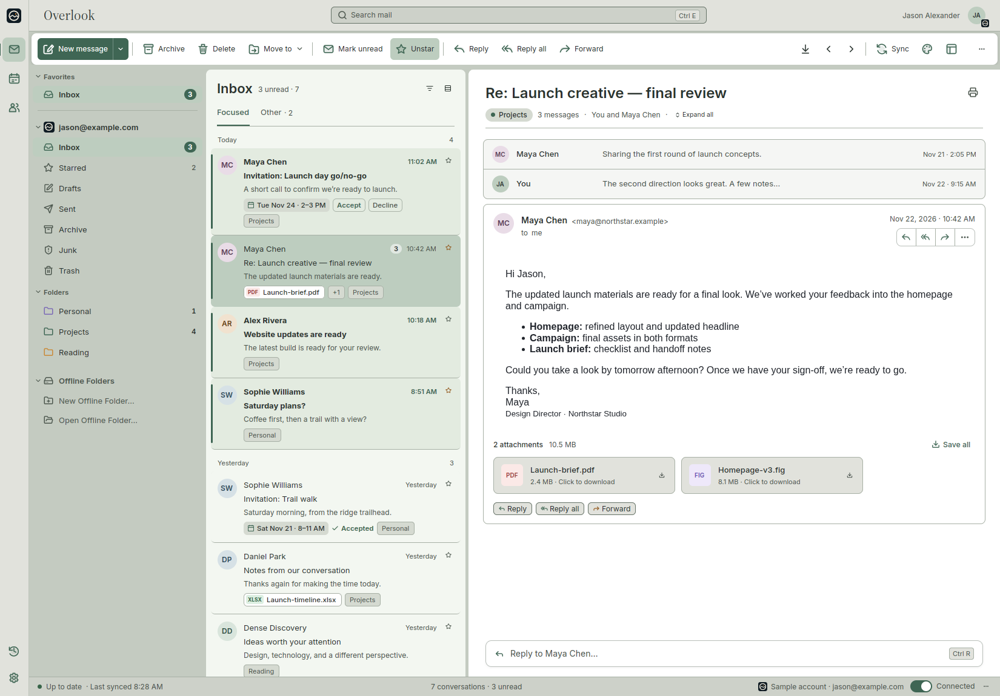
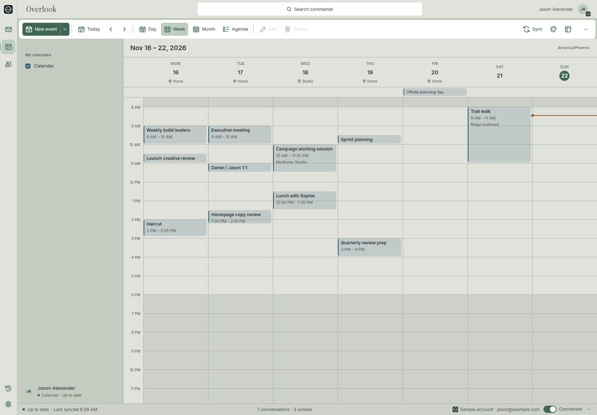
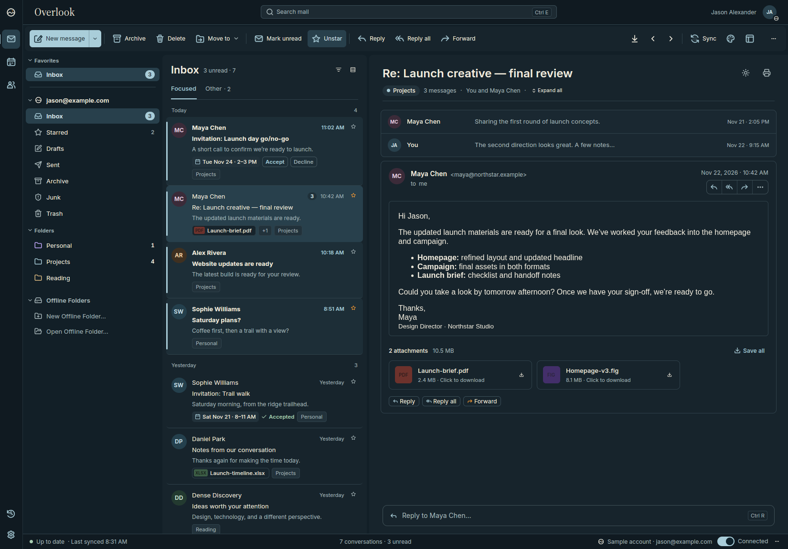
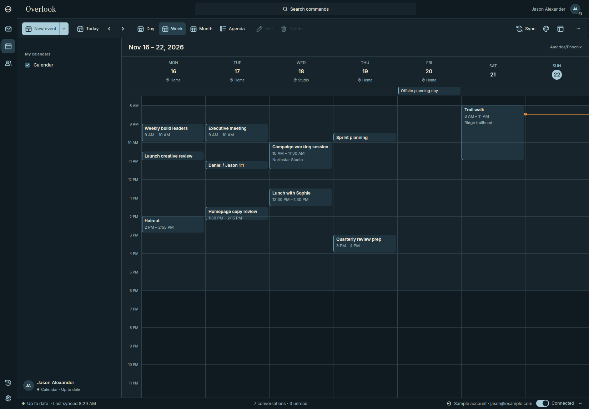
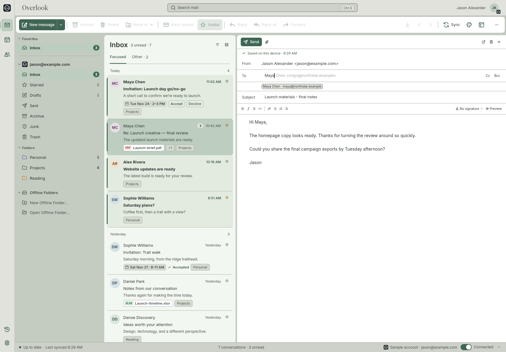
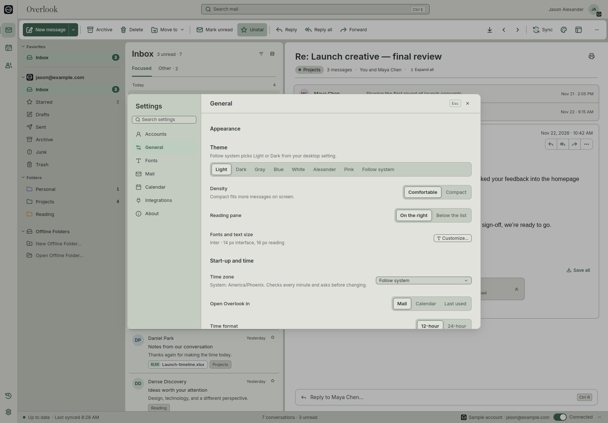

<p align="center">
  
</p>

<p align="center">
  <strong>A calmer place for your mail.</strong> A native mail and calendar client for Linux and macOS, written in Rust.<br>
  By <a href="https://lastrefuge.ai/">Last Refuge</a>.
</p>

<p align="center">
  <a href="#install"></a>
  
  
  
  
</p>

---

## Install

**[macOS](#install-on-macos) (Apple Silicon and Intel)**

```bash
(set -eu; url=https://github.com/last-refuge/overlook/releases/latest/download; tmp=$(mktemp -d); trap 'rm -rf "$tmp"' EXIT; cd "$tmp"; curl -fsSLO "$url/SHA256SUMS"; archive=$(awk -v arch="$(uname -m)" '$2 ~ ("-" arch "-macos[.]zip$") {print $2; exit}' SHA256SUMS); test -n "$archive"; curl -fsSLO "$url/$archive"; awk -v name="$archive" '$2 == name' SHA256SUMS | shasum -a 256 -c -; ditto -x -k "$archive" .; mkdir -p "$HOME/Applications"; mv -n Overlook.app "$HOME/Applications/")
```

**Arch Linux, Omarchy, and [compatible x86-64 Linux](#linux-tarball)**

```bash
curl -fsSL https://raw.githubusercontent.com/last-refuge/overlook/main/install.sh | bash
```

**Ubuntu and other Linux source builds** · [Install the build prerequisites first](#ubuntu-and-other-linux-source-builds).

```bash
curl -fsSL https://raw.githubusercontent.com/last-refuge/overlook/main/install.sh | bash -s -- --source
```

[Latest downloads](https://github.com/last-refuge/overlook/releases/latest) · [Installation details](#installation-details) · [Updates](#updates) · [MCP setup](docs/overlook-mcp.md)

---

Overlook brings the familiar **New Outlook** layout to Linux and macOS with a spacious three-pane
workspace, a Focused Inbox, a real calendar, and a composer that feels finished. It is **local-first**: your
mail and events live in a database on your machine, every change is saved on this device before it is sent,
and you can read, search, write, and file mail with no connection at all.

<p align="center">
  
</p>

<p align="center"><sub>The inbox in Light. Fictional sample mail, included with the app.</sub></p>

## What you get

- **Mail the Outlook way.** Account and folder sidebar, message list with day groups, a generous reading
  pane you can move below the list, comfortable and compact density, resizable panes that remember their size.
  A slim icon rail switches between Mail, Calendar, and Contacts; the toolbar keeps each module's actions
  close at hand, with crisp two-tone icons that follow your color scheme.
  Drag toolbar buttons into your preferred order or between the strip and More; each module remembers
  your layout. More → Customize toolbar also offers keyboard controls and a reset option.
- **Focused Inbox.** The Inbox splits into Focused and Other based on provider hints, who you write to,
  and your choices. Right-click a conversation in Other and choose **Move to Focused Inbox** to move it
  and send future Inbox mail from that sender to Focused. The toolbar also offers one-time moves and a
  standing sender rule.
- **Reading that respects you.** Received HTML uses isolated Chromium layout inside the native shell;
  scripts never run and remote images/fonts are blocked until you ask. Authored cards, panels and tables
  keep their browser layout, with smooth native scrolling and no blank flash during reflow.
  If the renderer fails, available content stays visible with a Retry action. Image and PDF attachments show thumbnails
  and open in a quick look (PDFs through poppler's `pdftoppm`, which Omarchy ships); everything else opens with
  your system apps, except programs and scripts, which Overlook never launches. Every message has Reply, Forward, Print, Save
  as .eml and View source, and long threads expand or collapse in one click.
- **Writing.** New, reply, reply all, forward, with autosave to the device, recipient suggestions from your
  Google Contacts and people you have written to, attachments (a forward brings the original's along), several named HTML signatures per account (with pictures, a small
  formatting editor, and a picker in the composer), and `mailto:` links from other apps. Formatting as you type: bold, italics, links,
  lists, quotes and code, styled live in the editor with the marks still visible, a Preview of exactly what
  recipients get, and the quoted original kept out of your way below the reply. Like Gmail, Overlook does not
  send programs, scripts, or installers (`.exe`, `.msi`, `.sh`, `.desktop`, `.AppImage` and similar), files whose
  content is one under another name, or `.zip`/`.tar` archives containing them.
- **Drafts across devices.** Gmail and IMAP drafts sync both ways, including attachments and inline images.
  Offline changes wait for a connection; conflicting edits are preserved as separate drafts. POP3 drafts stay local.
- **A calendar, not an afterthought.** Day, Week, Month, and Agenda. Invitations with Accept, Tentative, and
  Decline, from the calendar or from the email itself. Drag across empty time to create an event, right-click one to edit, duplicate, or delete
  it, drag events to move or resize them, edit one occurrence of a repeating event or the whole series, invite guests and check whether they
  are free, add a Google Meet link. Due reminders open in a separate window and also appear as desktop
  notifications. Open the event, join its meeting, snooze, dismiss one reminder, or dismiss all. Working hours
  are shaded, and Google's event colors are supported.
- **Offline, properly.** Archive, star, move, reply, and send while disconnected; everything is queued in order
  and replayed when you are back. A visible Outbox says *Waiting for connection*; *Sent* appears only after
  Gmail accepts the message, and a dropped connection mid-send is reconciled before any retry so nothing is
  sent twice. Survives a crash or a restart.
- **A theme for your taste.** Light, Dark, Gray, Blue, White, Alexander, and Pink, with *Follow system*
  selecting Light or Dark. Bundled Inter and Source Serif 4 so it
  looks the same on every machine. Keyboard shortcuts you already know from Outlook.
- **Contacts.** A third module beside Mail and Calendar: your Google Contacts and the people you have written
  to, searchable, with a detail card, add, edit and delete that sync back to Google, and one click to write to
  someone or find everything they sent. Changes made offline wait in the same queue as mail.
- **Any mailbox.** Gmail through its API, and IMAP or POP3 accounts for everything else: type your address
  and password, Overlook looks the servers up (common providers are built in, then Thunderbird's database),
  tests the connection, and keeps the password in the system keyring. IMAP folders become labels, new mail
  arrives the moment the server announces it, changes sync back as moves and flags, and sending goes over
  SMTP. POP3 downloads and keeps your mail here, with a backup button. Scripted servers only so far; see the
  status below.
- **Settings that do things.** Accounts and signatures, notifications, sync interval, mark-as-read timing,
  remote content, download size, working hours, reminders, time-zone overrides, automatic replies (out of office), and more. Every
  control takes effect immediately.
  Mail and calendar use date-aware daylight-saving rules. Overlook checks for system time-zone changes
  every minute and asks before switching; keeping the current zone saves an override.
- **System tray and background sync.** The Overlook mark appears in compatible system trays while the app
  runs, with a dot when the Inbox has unread mail. Open **Calendar reminders** from the tray menu or run
  `overlook --reminders`. Settings → General → *Keep running when the window is closed* keeps mail and calendars
  syncing and reminders active after you close the windows. <kbd>Ctrl</kbd>+<kbd>Q</kbd>, the tray menu or
  `overlook --quit` quits. *Start Overlook when you log in* adds an autostart entry, which starts it
  without a window when it keeps running in the background. Launching Overlook again always brings the
  running one forward rather than starting a second copy.

<p align="center">
  
</p>
<p align="center"><sub>Week view with meetings, working locations, and an all-day event.</sub></p>

<table>
  <tr>
    <td></td>
    <td></td>
  </tr>
  <tr>
    <td align="center"><sub>Dark theme</sub></td>
    <td align="center"><sub>Calendar in Dark</sub></td>
  </tr>
  <tr>
    <td></td>
    <td></td>
  </tr>
  <tr>
    <td align="center"><sub>Composer with recipient suggestions</sub></td>
    <td align="center"><sub>Settings</sub></td>
  </tr>
</table>

## Installation details

Download packages and checksums from the [latest release](https://github.com/last-refuge/overlook/releases/latest).
Overlook uses sandboxed Chromium to display message bodies. The Arch package installs Chromium.
On other systems, install Chrome or a compatible Chromium, or set `OVERLOOK_BROWSER_BIN` to
its executable. See [message rendering and isolation](docs/message-formatting.md).

### Arch Linux and Omarchy

The installer verifies the x86-64 package against the release checksum and installs it with
`pacman`. On other supported Arch architectures it builds from source. On Omarchy, press
<kbd>Super</kbd>+<kbd>Space</kbd> and type **Overlook**.

### Linux tarball

On compatible x86-64 Linux distributions, install the verified release tarball to `~/.local`.
The 2.1.0 tarball requires glibc 2.44 or newer. Run `getconf GNU_LIBC_VERSION` to check your version.

### Ubuntu and other Linux source builds

On Ubuntu, install the native dependencies first.

```bash
sudo apt update && sudo apt install ca-certificates curl git build-essential pkg-config libssl-dev libwayland-dev libxkbcommon-dev libxkbcommon-x11-dev libxcb1-dev libfontconfig1-dev libfreetype-dev libvulkan1 mesa-vulkan-drivers gnome-keyring desktop-file-utils
```

On other distributions, install the equivalent packages. Then install [Rust via rustup](https://rustup.rs)
and open a new terminal. The [source install command](#install) builds current `main` and installs it for your user.

If you already have a source checkout, run `make install PREFIX="$HOME/.local"` from its root.
Start Overlook from your application menu or run `"$HOME/.local/bin/overlook"`.
For Gmail on a source build, [set up your own Google OAuth client](#using-your-own-google-cloud-project-optional).

Linux installer options include `--dry-run` to preview the install, `--prefix DIR` to choose a
directory, `--source --ref REF` to build a branch or tag, and `--yes` to skip prompts. See [the installer](install.sh).

### Install on macOS

The [macOS install command](#install) selects the ZIP for your Mac, verifies the published SHA-256 checksum,
and installs Overlook to `~/Applications`. For an existing install, follow [Updates](#updates).

Open **Overlook.app** from that folder or run `open "$HOME/Applications/Overlook.app"`. You can also
download the `arm64-macos.zip` (Apple Silicon) or `x86_64-macos.zip` (Intel) archive from the
[latest release](https://github.com/last-refuge/overlook/releases/latest) and drag **Overlook.app** from the
unzipped folder to Applications. The app uses ad-hoc signing, so macOS may ask you to approve it on first launch.
See [Apple's instructions for opening the app](https://support.apple.com/en-us/102445). Install Chrome or Chromium
in `/Applications` for message rendering. Overlook keeps passwords and sign-in tokens in Apple Keychain.

#### Build from source

With [Rust via rustup](https://rustup.rs) and Xcode's Metal toolchain installed, clone, build,
and run Overlook in one command.

```bash
git clone https://github.com/last-refuge/overlook.git && cd overlook && cargo run --release --locked -p overlook
```

If you already have a checkout, run `cargo run --release --locked -p overlook` from its root.

### First launch

On first launch, Overlook opens on its welcome page. Choose a mail provider or select
**Look around in a sample mailbox first**. The sample account's connection is a switch
in the status bar. Flip it to watch offline changes sync. To add another account later,
choose **Add account** in Settings → Accounts or in the account menu.

### Connect an MCP client

Overlook's Model Context Protocol (MCP) server gives clients such as Codex CLI and Claude Code
access to the accounts and actions you select in **Settings → Integrations**. You can connect
while the desktop is running, run Overlook headlessly, or try fictional data in a separate profile.
Follow the [MCP setup guide](docs/overlook-mcp.md) for installation, client configuration, and a first test.

### Updates

Overlook checks GitHub for a new release once a day and shows a banner when one is available.
You can turn off this check in Settings → About. On Arch and on Linux systems that use the
release tarball, **Update now** verifies and installs the new package. Choose
**Restart Overlook** to finish. For a Linux source install, rerun the source command.
On macOS, quit Overlook and replace **Overlook.app** with the app from the new ZIP.

### Uninstall

On Arch, turn off **Start Overlook when you log in** in Settings if you enabled it, then run
`sudo pacman -Rns overlook`. For other Linux installs, run `bash install.sh --uninstall` from a checkout.
On macOS, move **Overlook.app** to the Trash.
Uninstalling leaves your local mail and settings in your profile.

## Connect Gmail

Overlook talks to Gmail, Google Calendar and Google Contacts directly through Google's APIs, from your machine.
Nothing passes through a Last Refuge server.

1. Choose **Add account** (Settings → Accounts, or the account menu at the bottom of the sidebar), then
   **Gmail**. A new install opens on that page.
2. Sign in with Google in your browser and approve Overlook's access.

Repeat for more accounts. Overlook is verified by Google for the Gmail, Calendar and Contacts access it asks for.
Tokens are stored in Apple Keychain on macOS or in the system keyring on Linux (GNOME Keyring or KWallet through
the Secret Service), never in files. The [native app guide](llm-docs/overlook-native-app.md#gmail) has the details, and the
[secrets access policy](docs/secrets-policy.md) lists every stored secret, who can reach it, and how access is logged.

### Using your own Google Cloud project (optional)

Release builds carry Overlook's own Google sign-in. Builds compiled from source don't, and anyone who prefers
their own Google Cloud project can use it instead:

1. In [Google Cloud](https://console.cloud.google.com), create a project and enable the **Gmail API**, the
   **Google Calendar API** and the **People API**.
2. Configure the consent screen (External, Testing), add yourself as a test user, and add these scopes:
   `gmail.modify`, `gmail.send`, `gmail.settings.basic`, `calendar.events`, `calendar.readonly`,
   `contacts`, `contacts.other.readonly`, `openid`, `userinfo.email`.
3. Create an OAuth client of type **Desktop app**, download its JSON, and save it as
   `~/.config/overlook/google-oauth-client.json`. When that file exists, Overlook signs in with it.

In Google's *Testing* mode you will be asked to sign in again every seven days. Accounts signed in with one client
need to sign in again after switching to the other, because Google only refreshes a sign-in through the client
that issued it.

## Connect Microsoft

Outlook.com, Hotmail, Live and MSN addresses and Microsoft 365 work or school accounts are read over IMAP (or
POP3) and sent over SMTP. You sign in with Microsoft in your browser. Overlook never sees your password, and it
keeps the sign-in Microsoft issues in your system keyring.

1. Choose **Add account** (Settings → Accounts, or the account menu at the bottom of the sidebar), then
   **Microsoft**.
2. Enter your address and choose **Sign in with Microsoft**, then approve Overlook in the browser.
3. Overlook fills in Microsoft's server settings, checks both servers, and adds the account.

An Outlook.com address entered as an IMAP or POP3 account switches to this sign-in by itself, because Microsoft
no longer accepts passwords from mail apps. Microsoft 365 organizations may need an administrator to approve
Overlook first, and some turn off IMAP, POP or SMTP sign-in for mail apps; Overlook tells you which. Outlook.com
accounts set up as POP3 need POP turned on in Outlook.com's settings.

There's nothing to set up first: Overlook comes with Last Refuge's Microsoft app registration built in, so a fresh
install can sign in straight away. To use your own registration instead, register a public client in Microsoft
Entra (redirect URI `http://localhost`, personal and work accounts) and save
`{"client_id": "<application id>"}` as `~/.config/overlook/microsoft-oauth-client.json` (add `"tenant"` to limit
sign-in to one directory; it defaults to `common`). That file takes priority over the built-in registration, and
Settings → About shows which one is in use. Packagers can build in their own with `OVERLOOK_MICROSOFT_CLIENT_ID`.
The [Microsoft account notes](llm-docs/microsoft-mail.md#the-app-registration) have the details.

## Connect iCloud

Choose **Add account** (Settings → Accounts, or the account menu at the bottom of the sidebar), then
**iCloud Mail**. iCloud wants an **app-specific password**, not your Apple Account password: create one
at [account.apple.com](https://account.apple.com) under Sign-In and Security → App-Specific Passwords (your
account needs two-factor authentication), then paste it into Overlook, which keeps it in your system keyring.
Overlook fills in Apple's server settings and finds which user name iCloud wants. For an iCloud+ address at your
own domain, use your iCloud Mail address as the user name. iCloud doesn't offer POP, so it's always IMAP.

## Connect Yahoo or AOL

Choose **Add account**, then **Yahoo Mail** or **AOL Mail**. Both want an **app password**, not your
account password: create one in your account's Account Security settings
([Yahoo](https://login.yahoo.com/account/security): External connections → Create app password;
[AOL](https://login.aol.com/account/security): Generate app password, after turning on two-step verification),
then paste it into Overlook. Spaces in it don't matter. Yahoo only offers app passwords in a browser you've used to
sign in to Yahoo for several days. Overlook fills in the server settings; both work over IMAP or POP3.

## Connect Fastmail

Choose **Add account**, then **Fastmail**. Fastmail wants its own **app password** for each mail app:
create one in Fastmail under Settings → Privacy & Security → Manage app passwords and access → New app password,
and keep its default access (Mail, Contacts & Calendars) if you'd like Overlook to connect your calendars too.
Fastmail's Basic plan doesn't include mail apps. Overlook fills in the server settings, for IMAP or POP3.

## Connect Proton Mail

Proton Mail works through [Proton Mail Bridge](https://proton.me/mail/bridge), Proton's desktop app for paid plans.
Bridge must be running and signed in on the same computer. Choose **Add account**, then **Proton Mail**, and use
the password Bridge shows in the account's mailbox details, not your Proton password. Bridge encrypts the connection
with a certificate it made itself, so the first connection test asks you to trust it, and the account can't be added
until you do. Overlook then accepts that certificate, and no other, from Bridge on this computer. If Bridge's
certificate ever changes, Overlook stops and asks again. The settings are filled in with Bridge's defaults (IMAP
127.0.0.1:1143 and SMTP 127.0.0.1:1025 with STARTTLS); change them if you changed them in Bridge.

## Keyboard

| Key | Action |
| --- | --- |
| <kbd>Ctrl</kbd>+<kbd>N</kbd> | New message |
| <kbd>Ctrl</kbd>+<kbd>R</kbd> / <kbd>Ctrl</kbd>+<kbd>Shift</kbd>+<kbd>R</kbd> / <kbd>Ctrl</kbd>+<kbd>F</kbd> | Reply / Reply all / Forward |
| <kbd>Ctrl</kbd>+<kbd>Enter</kbd> | Send |
| <kbd>Ctrl</kbd>+<kbd>B</kbd> / <kbd>I</kbd> / <kbd>K</kbd> | Bold / italic / link while writing |
| <kbd>Ctrl</kbd>+<kbd>Shift</kbd>+<kbd>8</kbd> / <kbd>7</kbd> / <kbd>9</kbd> | Bulleted list / numbered list / quote |
| <kbd>Ctrl</kbd>+<kbd>Shift</kbd>+<kbd>P</kbd> | Preview the message |
| <kbd>Ctrl</kbd>+<kbd>E</kbd> | Search this device, then Gmail |
| <kbd>J</kbd> / <kbd>K</kbd> | Next / previous conversation |
| <kbd>E</kbd> | Archive, or Move to Inbox when already archived |
| <kbd>Delete</kbd> | Move to Trash |
| <kbd>S</kbd> / <kbd>U</kbd> | Star / toggle read |
| <kbd>Ctrl</kbd>+<kbd>1</kbd> / <kbd>2</kbd> / <kbd>3</kbd> | Mail / Calendar / Contacts |
| <kbd>Ctrl</kbd>+<kbd>Shift</kbd>+<kbd>A</kbd> | New event |
| <kbd>←</kbd> <kbd>→</kbd> <kbd>T</kbd> <kbd>D</kbd> <kbd>W</kbd> <kbd>M</kbd> <kbd>A</kbd> | Calendar: move, today, day, week, month, agenda |
| <kbd>Enter</kbd> / <kbd>Delete</kbd> | Calendar: edit / delete the selected event |
| <kbd>Ctrl</kbd>+<kbd>,</kbd> | Settings |
| <kbd>Ctrl</kbd>+<kbd>Q</kbd> | Quit Overlook (closing the window keeps it running when that's on) |
| <kbd>Esc</kbd> | Close composer or settings, clear search |

Drag a conversation onto Inbox, Archive, Trash, Starred, or a label in the sidebar to move it. Every move
has Undo.

## Built with

Rust and [GPUI](https://gpui.rs), Zed's GPU-accelerated UI framework, through [GPUI Kit](https://gpui-kit.com).
SQLite with FTS5 for local storage and search. A native shell, no Electron; sandboxed Chromium renders
interactive message bodies through private pipes, without an exposed debugging port.
See the [message formatting review](docs/message-formatting.md) for rendering policy, regression coverage,
and native HTML layout limitations.

```
crates/overlook-core       domain model, Focused Inbox rules, HTML sanitizer, time zones, preferences
crates/overlook-store      SQLite: messages, drafts, Outbox, pending operations, calendars, events, settings
crates/overlook-provider   provider traits, the Gmail and Google Calendar providers, the sample provider
crates/overlook-app        the GPUI application: shell, sync engine, keyring, sign-in, notifications
branding/                  brand system, fonts, logos, design previews
packaging/                 desktop entry, AppStream metadata, PKGBUILD, Flatpak manifest draft
llm-docs/                  product plan, brand system, architecture and implementation notes
```

Run the tests with `cargo test --workspace`. Received HTML is sanitized without flattening authored
layouts, then rendered by isolated Chromium. Scripts are disabled and remote images, stylesheets and
fonts are consent-gated. Originals remain unchanged. Printing and outgoing quotes still use the safe
native subset; see [rendering policy and limits](docs/message-formatting.md).

## Status

Early daily use by its author on Omarchy (Hyprland, Wayland). Gmail accounts work end to end. IMAP/SMTP and
POP3 are tested against scripted servers, and real Outlook.com (Microsoft sign-in), iCloud, Yahoo, Fastmail and Proton
Mail (through Bridge) accounts have been tried by hand. Treat other services, and Microsoft 365 work accounts, as beta. A Flatpak build,
GNOME, KDE, and screen-reader testing are still to be done. Open an issue with what you did, what you saw, and what you
expected.

## Brand and credits

The horizon mark, wordmark, palette, and typography are documented in [`llm-docs/overlook-brand.md`](llm-docs/overlook-brand.md).
Fonts: [Inter](https://rsms.me/inter/) and [Source Serif 4](https://github.com/adobe-fonts/source-serif) under the
SIL Open Font License. Icons: [Lucide](https://lucide.dev) (ISC). Overlook is a Last Refuge product.

## License

Overlook is released under the [MIT License](LICENSE). Copyright © 2026 Last Refuge.

The vendored [`vendor/gpui-base`](vendor/gpui-base) keeps its own Apache-2.0 license, and the bundled fonts and icons keep
the licenses listed above.
