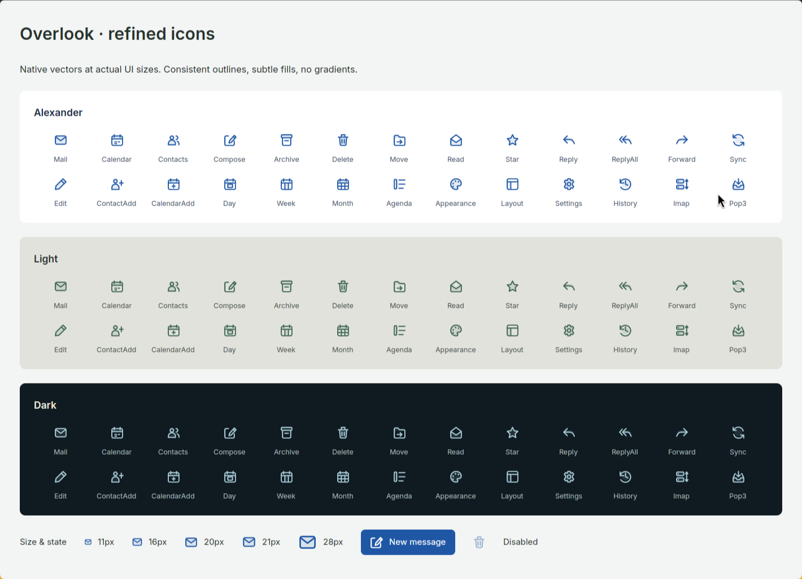

# Overlook color icons

Original vector artwork created for Overlook. No external icon pack or logo assets are used.

The 24-unit drawings use consistent 1.8-unit rounded outlines and a quiet fill. They are designed for the 16–21 pixel controls in the mail UI, with enough separation to remain legible in small badges. There are no gradients, white highlight edges, or miniature multicolor details.

Each SVG has two flat groups, `fill` and `stroke`. `assets.rs` exposes these as separate native GPUI `svg` masks. GPUI rasterizes each mask for the control's actual bounds and monitor scale; do not render working icons with `img`, which rasterizes at the SVG's intrinsic size and then resizes the texture. That large downsampling step made the old icons look stippled at toolbar sizes.

The native stroke uses `Palette::action` (or `on_action` on a primary button), with the fill at 12% of the same color. Colors are applied at paint time, so built-in and live system-theme changes do not need new image-cache entries. Source SVG colors provide a standalone Light-theme preview. Provider logos and the Overlook brand mark are separate assets and retain their original artwork.

Regenerate with `python3 branding/source/build_icons.py`. Keep the two named groups flat; the asset loader deliberately extracts only this controlled format. `cargo run -p overlook --example icon_gallery` opens a native proof sheet with every icon in Alexander, Light and Dark, plus small sizes and button states, without opening a mail profile.

